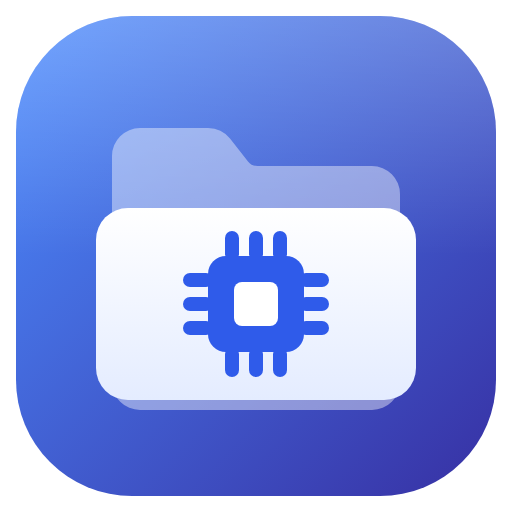
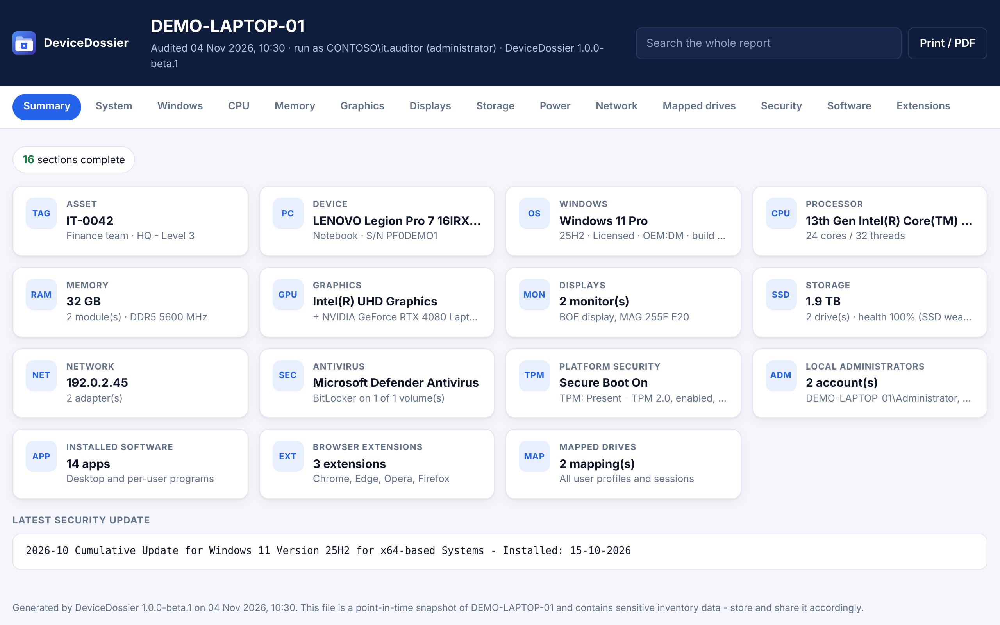
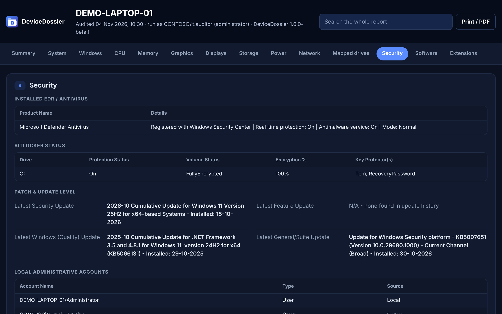

<p align="center">
  
</p>

<h1 align="center">DeviceDossier</h1>

<p align="center">
  A portable Windows inventory and audit tool. Run it from a USB drive or a script and get a complete dossier of the PC
  (hardware, Windows, software, users' mapped drives and security settings) as Excel, HTML and XML.
</p>

<p align="center">
  
  
  
  
</p>

<p align="center">
  Built by <a href="https://flickerdampa.github.io/">FlickerDampa</a>, security researcher and engineer.
</p>

<p align="center">
  
</p>

---

## Why

Auditing office PCs and laptops usually means clicking through System Information, Device Manager, `winver`, BitLocker
settings and a dozen registry keys on every machine. DeviceDossier does it in one pass, with nothing to install, and
produces the same report layout every time, so audits can be compared or merged into an inventory.

It only reads. It never changes settings on the PC it audits, and it sends nothing over the network.

## Features

- **Portable.** One `DeviceDossier.exe` for Windows 10 and 11. .NET Framework 4.8 is part of Windows, so there is nothing to install and nothing is left behind.
- **Three report formats.**
  - **Excel** (`.xlsx`): one formatted sheet, written natively, so Office isn't needed to create it.
  - **HTML**: a self-contained page with tabs, search across the whole report, sortable tables, dark mode and a print / PDF layout. It works offline in any browser. See [`docs/sample-report.html`](docs/sample-report.html).
  - **XML**: structured data with a published [schema](docs/report-schema.xsd), for importing into other tools or reopening in DeviceDossier.
- **Asset record.** Optionally enter an asset tag, assigned user, location and notes at audit time. They appear at the top of the report.
- **Choose where reports go.** Save to the Desktop, any connected USB drive (detected as drives come and go), or any local, mapped or UNC folder. It warns you when a folder is synced to OneDrive.
- **In-app viewer.** CPU-Z-style tabs for every area, with searchable, copyable lists. Saved XML reports from any PC can be opened again and re-exported.
- **Light, dark and High Contrast.** Follows the Windows app theme by default, including the title bar, or set it in Settings.
- **Settings with import and export.** Configure defaults, known file servers, excluded disks and time limits in the app, then export them to set up other copies the same way.
- **Command line.** `DeviceDossier.exe --silent` runs a full audit with no window, for scheduled tasks, Group Policy, Intune or RMM tools.
- **Fault-tolerant.** Each section has a time limit. If Windows stops answering, that section is marked as an error and the audit carries on.
- **Admin-aware.** It asks for administrator rights at startup (you can turn this off). Without them it runs in limited mode and marks what it couldn't read.

<p align="center">
  
</p>

## What it collects

| Section | Details |
|---|---|
| 0. Asset record | Asset tag, assigned to, location / department, notes (only when entered) |
| 1. Device | Chassis type, name, manufacturer, model and model name, domain / workgroup, BIOS serial, version and date, system UUID, SMBIOS asset tag |
| 2. Windows | Edition, version, display version (e.g. 25H2), full build, architecture, install date, last boot, activation status, product key (masked by default) and channel |
| 3. CPU | Model, cores / threads, clock speeds, CPU ID, socket, architecture, L2 / L3 cache |
| 4. Memory | Every module: capacity, manufacturer, part number, serial, speed, type, slot, bank, form factor |
| 5. Graphics | Name, real VRAM (not capped at 4 GB), driver version and date, resolution, refresh rate, PCI IDs, VBIOS version, and GPU UUID on NVIDIA cards |
| 6. Storage | Model, real serial number (including NVMe), size, bus type (NVMe / SATA / USB…), SSD or HDD, partitions, firmware, wear-based health |
| 6b. Motherboard | Manufacturer, product, serial, version, status |
| 6c. Power | Battery health, design vs full-charge capacity, charge and status on laptops; PSU on desktops |
| 7. Network | Physical adapters, plus virtual ones that have an address: MAC, IP, subnet, gateway, DHCP, DNS |
| 8. Mapped drives | Mapped drives and saved network locations for **every local user profile**, including logged-off users and drives mapped only in a signed-in session, checked against your known servers |
| 9. Security | Antivirus / EDR, Microsoft Defender status, BitLocker per volume with key protectors, latest security, feature, quality and general updates, local Administrators group |
| 10. Software | Installed programs (64-bit, 32-bit and the current user's) with version, publisher, install date and location. Each installed version is listed separately |
| 10b. Extensions | Chrome, Edge, Opera and Firefox extensions for every user profile |
| 11. Displays | Connected monitors: manufacturer, model, serial number, manufacture date, size, connection type |
| 12. Security baseline | UEFI / legacy BIOS, Secure Boot, TPM, firewall per profile, UAC, Remote Desktop, SMBv1, Guest account, Defender signatures, pending restart |

Everything comes straight from Windows: WMI, the registry and the storage and display drivers, plus `nvidia-smi` when an NVIDIA driver is installed. No third-party tools are needed.

## Download and use

1. Download `DeviceDossier.zip` from [Releases](../../releases) and check it against `SHA256SUMS.txt`:
   ```powershell
   Get-FileHash .\DeviceDossier.zip -Algorithm SHA256
   ```
2. Extract it, for example to a USB drive.
3. On the PC to audit, double-click `DeviceDossier.exe` and accept the administrator prompt.
4. Choose where to save and which formats you want, optionally fill in the asset details, then click **Run full audit**.

Reports are named `IT_Audit_<DEVICE>_<ddMMyyyy_HHmm>` (the prefix can be changed). By default they go into a
`DeviceDossier Reports` folder on the Desktop.

> **Windows SmartScreen and antivirus.** Beta builds are not code-signed yet, so Windows may show *"Windows protected
> your PC"*. Choose **More info → Run anyway**, or build from source. Because the tool reads product keys, other users'
> profiles and browser data, some antivirus products may flag it as a "potentially unwanted" hacking tool. Check the
> SHA-256 against the release, and report false positives to your vendor (for Microsoft Defender, use the
> [submission portal](https://www.microsoft.com/wdsi/filesubmission)).

## Settings

Open **Settings** in the sidebar to set:

- the default save location (Desktop, USB drive or a specific folder), sub-folder and file name prefix
- the default formats and sections
- product key masking (on by default) and whether to leave the USB drive DeviceDossier runs from out of Storage
- disk models to ignore, such as card readers
- the Windows Update history timeout and the time limit for each section
- **known file servers**, so mapped drives are reported as `Yes - <label>` or `No - Unrecognized server`
- whether to ask for administrator rights at startup
- the theme

Settings are saved to `DeviceDossier.settings.xml` next to `DeviceDossier.exe`, so they travel with a USB drive. If
that folder is read-only they are saved to `%APPDATA%\DeviceDossier`. Use **Export…** and **Import…** to copy them
between installs. A sample is in [`config/DeviceDossier.settings.example.xml`](config/DeviceDossier.settings.example.xml).
Settings files from the tool's earlier name, SysAudit (`SysAudit.settings.xml` and `SysAudit.ini`), are picked up and
converted automatically.

## Command line

```
DeviceDossier.exe --silent [--output "D:\Audits"] [--formats xlsx,html,xml]
                  [--settings "\\server\share\DeviceDossier.settings.xml"]
                  [--skip drives,security,patches,software,extensions]
                  [--asset-tag IT-0042] [--assigned-to "Finance"] [--location "HQ"] [--notes "..."]
                  [--log "C:\Logs\devicedossier.log"]
```

| Option | Meaning |
|---|---|
| `--silent` | Run a full audit without showing a window. It never prompts for elevation. |
| `--output` | Folder for the reports. Defaults to the location in the settings. |
| `--formats` | Any of `xlsx`, `html`, `xml`, or `all`. |
| `--settings` | Use a specific settings file, for example one shared on the network. |
| `--skip` | Sections to leave out. |
| `--asset-tag`, `--assigned-to`, `--location`, `--notes` | Fill in the asset record. |
| `--log` | Append progress messages to a log file. |
| `--help` | Show usage. |

Exit codes: `0` reports saved, `1` audit failed, `2` invalid arguments. Run it as an administrator or as SYSTEM for
complete results, and always pass `--output` when running as SYSTEM.

DeviceDossier is a Windows app, so command prompts don't wait for it on their own. In `cmd` use `start /wait`, and in
PowerShell pipe it to `Out-Null`. Then check `%ERRORLEVEL%` or `$LASTEXITCODE`. For example, to collect every PC's audit
on a share:

```powershell
& "\\server\it\DeviceDossier\DeviceDossier.exe" --silent --formats xlsx,xml --output "\\server\it\Audits\$env:COMPUTERNAME" | Out-Null
```

## Administrator vs limited mode

Without administrator rights, these can't be read and are marked **requires administrator**: BitLocker status, SSD
wear counters, battery capacity on some laptops, TPM details, and other users' saved drive mappings, network locations
and browser extensions. Everything else works normally.

Saved profiles of logged-off users are opened privately and read-only (`RegLoadAppKey`). Nothing is mounted in the
system registry, so a failed read can't affect that user's next sign-in.

## Privacy

A report contains sensitive information: serial numbers, MAC and IP addresses, user names, server paths, installed
software and, unless masked, the Windows product key. See [PRIVACY.md](PRIVACY.md) for exactly what is collected. Only
audit devices you are authorised to audit, and store reports somewhere access-controlled.

## Build from source

Requirements: Windows with the [.NET SDK 8](https://dotnet.microsoft.com/download) or Visual Studio 2022. The
.NET Framework 4.8 targeting pack is restored from NuGet; the included `NuGet.config` makes this work even on PCs that
only have Visual Studio's offline package source.

```powershell
git clone https://github.com/FlickerDampa/DeviceDossier.git
cd DeviceDossier
dotnet build src/DeviceDossier/DeviceDossier.csproj -c Release
```

The output is in `src/DeviceDossier/bin/Release/net48/`. `DeviceDossier.exe` and `DeviceDossier.exe.config` are all
you need.

GitHub Actions runs the tests, builds on Windows, runs a silent audit on the runner as a smoke test, and uploads the
sample reports. Pushing a tag such as `v1.0.0-beta.1` publishes a release with the zip and its SHA-256 checksums; tags
with a hyphen are marked as pre-releases.

### Tests

- `tests/XamlLint/check.py` checks the XAML without Windows:
  - every colour and style used exists
  - the light, dark and High Contrast palettes match
  - no name is used twice
  - every event handler exists
- `tests/ExportParity/run.sh` rebuilds an anonymised reference report:
  - compares the Excel output cell by cell, directly and after an XML save and reload
  - validates the XML against `docs/report-schema.xsd`
  - checks that the HTML report is generated

```bash
python3 tests/XamlLint/check.py
bash tests/ExportParity/run.sh
```

## Project layout

```
src/DeviceDossier/
  App.xaml(.cs)          startup, elevation prompt, crash logging
  Cli.cs                 --silent command-line mode
  MainWindow.xaml(.cs)   overview, progress, report and settings screens
  Themes/                light and dark palettes, control styles
  Views/                 in-app report tabs, theme switching (incl. High Contrast), view models
  Core/                  report model, audit engine, settings, report layout, quick system snapshot
  Collectors/            one class per area: device, OS, hardware, displays, network, security, software
  Export/                Excel (dependency-free .xlsx writer), HTML and XML report formats
  Util/                  WMI, registry hives, USB drives, shell links, JSON, process, elevation, folder picker
config/                  sample settings file
docs/                    XML schema, sample report, screenshots, icon sources (SVG)
tests/                   XAML checks, export parity and XML round-trip tests
```

## Contributing and security

Bug reports and pull requests are welcome; see [CONTRIBUTING.md](CONTRIBUTING.md). Please report security issues
privately as described in [SECURITY.md](SECURITY.md).

## License

[MIT](LICENSE)
